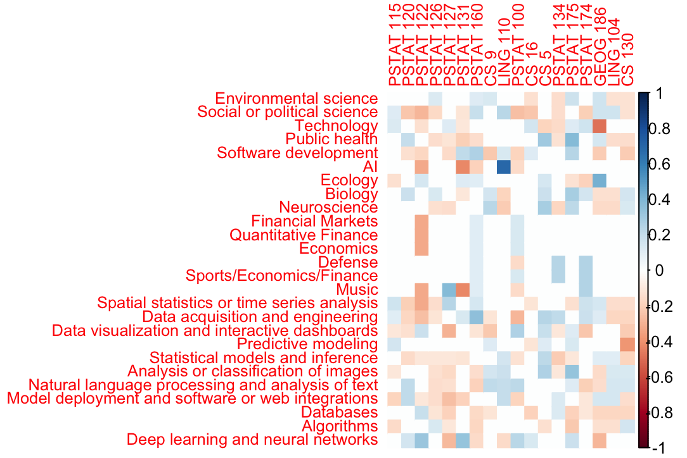
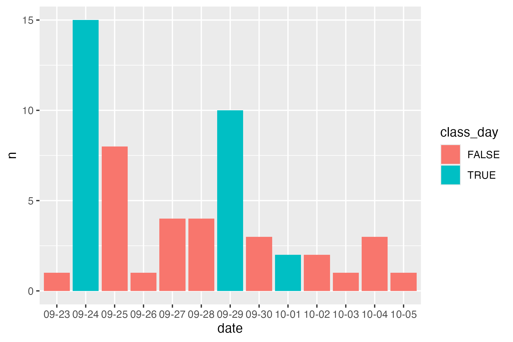
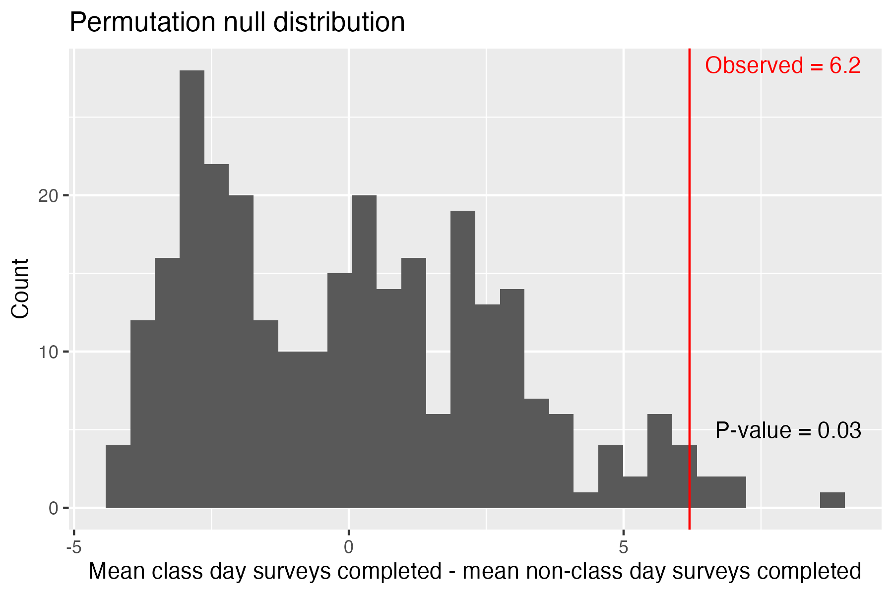

```{r, include = FALSE}
# load any other packages and read data here
library(tidyverse)
library(knitr)
school_eth <- read_csv('demographics/Sheet 3-school-wide ethnicity.csv')
school_gen <- read_csv('demographics/Sheet 4-school-wide gender.csv')
ds_eth <- read_csv('demographics/Sheet 1-ds ethnicity.csv')
ds_gen <- read_csv('demographics/Sheet 2-ds gender.csv')
class_eth <- read_csv('demographics/Sheet 5-class ethnicity.csv')
class_gen <- read_csv('demographics/Sheet 6-class gender.csv')

```

## Executive summary

Our group was interested in analyzing how students' recorded experiences and interests relate to their project choices and language preferences. We were interested in comparing the demographic information from the survey to the general Statistics and Data Science major and undergraduate university level. Our final analysis asked whether the distribution of survey response times was significant, and if there was a possible association with class days. We found that the correlation between project preference and coursework taken was insignificant, and that differences in Python or R preference was not significantly explained by domain or area interests. However, students with no coding language preference picked more domain interests on average, with those of no language preference selecting 5 options, while Python chose 3.7, and R 3.3. The demographic analysis revealed significant differences in ethnic composition of class respondents compared with the major and undergraduate student population, although gender was insignificant. Another thing we looked at was the survey response timing. In particular, we were interested in whether there was a significant difference between responses completed on class days versus non class days. To test this, we performed a permutation test. Since our hypothesis was formed from looking at the data, we cannot conclude the test based on a significance level, but the results suggest class days may have been associated with more surveys completed.

## Data description

The data come from a survey given to students in our class (PSTAT 197A) in fall 2026. There were 55 responses, submitted between September 23 and October 5, with a deadline of October 4 (54 on time, 1 late). The survey had two parts, a skills and background section and a project interests section, and students could consent to each part separately. 51 consented to the background part, 49 to the interests part, and 49 to both. Our analysis uses the 49 who did both, since the 2 who only did the background part drop out when the two files are merged. Each respondent has an artificial ID, so the two parts can be joined without identifying anyone.

The class is mostly seniors (49 of 55, 89%), with 5 juniors and 1 junior with senior credits. Nearly everyone is a Statistics and Data Science major (52 of 55, 95%), and about a third report a second major (Economics, Mathematics, and Applied Mathematics are the most common). The class is 55% male and 42% female, and 67% identify as Asian.

We also used outside data from the 2025-26 UCSB campus profile (bap.ucsb.edu), which reports raw counts of students by gender and ethnicity. It covers 21,509 undergraduates school-wide and 1,693 undergraduates in the Data Science major. We used these counts as a reference to test whether the gender and ethnicity makeup of our class differs from the major and from the school as a whole.

Finally, there was data on how many students completed the survey each day for the 2 weeks between assignment and deadline.

+---------------------------------+---------------------------------------------------------------------------------------------------------------------------------+
| Background                      | Measurements                                                                                                                    |
|                                 |                                                                                                                                 |
| (51 people)                     |                                                                                                                                 |
+:================================+:================================================================================================================================+
| prog/math/stat.prof             | Self-rated proficiency in programming, math, and stats (beginner, intermediate, advanced, relative to a typical UCSB undergrad) |
+---------------------------------+---------------------------------------------------------------------------------------------------------------------------------+
| prog/math/stat.comf             | Comfort level in each of those three areas (1 to 5 scale)                                                                       |
+---------------------------------+---------------------------------------------------------------------------------------------------------------------------------+
| upper_div_courses, courses      | Number of upper-division courses (3-5, 6-8, 9+) and which courses they completed                                                |
+---------------------------------+---------------------------------------------------------------------------------------------------------------------------------+
| domain_specialization, research | Whether they have a domain specialization, and whether they have research experience (yes, no, unsure)                          |
+---------------------------------+---------------------------------------------------------------------------------------------------------------------------------+

+-------------------+----------------------------------------------------------------------------------------------+
| Project Interests | Measurements                                                                                 |
|                   |                                                                                              |
| (49 people)       |                                                                                              |
+:==================+:=============================================================================================+
| type              | Preferred project type: industry (32), research lab (6), no preference (11)                  |
+-------------------+----------------------------------------------------------------------------------------------+
| language          | Preferred programming language: Python (22), no preference (16), R (11)                      |
+-------------------+----------------------------------------------------------------------------------------------+
| domains           | Application domains of interest (checkbox question, 8 standard options plus a few write-ins) |
+-------------------+----------------------------------------------------------------------------------------------+
| areas             | Areas of data science of interest (checkbox question, 11 options)                            |
+-------------------+----------------------------------------------------------------------------------------------+

## Questions of interest

Through our group's collaboration, we were interested in identifying a relationship between proficiency and comfort levels, and explored whether people overestimated or underestimated between these levels. Preference in coding languages was discussed, specifically if the interests in areas, domains, and average comfort influenced a respondent's choice of language. Likewise, the relationship among project preference and coursework was analyzed. We wanted to find if there were significant differences between the demographic of our class cohort, and the overall major and university level. We attempted to understand the relationship among timings of the survey submission and class times. After exploring our class response's variables, we sought to explain three overarching goals:

1.  How does a student's preferences/experience impact their project choices?
2.  How does our class demographic data compare to the school and the data science major as a whole?
3.  Is there a significant difference in surveys completed on class vs non class days?

## Findings

### 1. How does a student's preferences/experience impact their project choices?

One thing we did is we looked at whether a student's preferred programming language (Python, R, or no preference) relates to their domain interests and self-rated comfort. We used the 49 students who answered both survey sections (22 Python, 16 no preference, 11 R) and left out the 7 domains that only one student picked.

```{r}
processed <- read_csv("../data/background_interest_processed.csv")

domains <- names(processed)[31:45]
counts <- colSums(processed[domains])
keep <- names(counts[counts > 1])
processed$n_domains <- rowSums(processed[keep])
```

**Domain choices do not clearly differ by language.** Python is the most common preference in almost every domain, but it is also 45% of the class, so that alone is not a pattern.

```{r}
#| fig-width: 7
#| fig-height: 4
#| fig-cap: "Preferred language among students who picked each domain"
processed %>%
  pivot_longer(all_of(keep), names_to = "domain", values_to = "picked") %>%
  filter(picked == 1) %>%
  count(domain, language) %>%
  group_by(domain) %>%
  mutate(total = sum(n), pct = 100 * n / total) %>%
  ggplot(aes(reorder(domain, total), pct, fill = language)) +
  geom_col() +
  coord_flip() +
  labs(x = NULL, y = "% of students who picked the domain", fill = "Language")
```

**Students with no language preference picked more domains.** They picked about 5 on average, compared to about 3.7 for Python and 3.3 for R (p = 0.012). The gap was clear against R (adjusted p = 0.017) and weaker against Python (adjusted p = 0.049). One possible reason is broader interests, but our data cannot say why.

```{r}
#| fig-width: 5
#| fig-height: 3.5
#| fig-cap: "Number of domains picked, by preferred language"
ggplot(processed, aes(language, n_domains)) +
  geom_boxplot() +
  labs(x = NULL, y = "Number of domains picked")
```

**Comfort ratings were slightly higher for Python students, but not significantly.** The table shows group averages (comfort is rated 1 to 5) and Kruskal-Wallis p-values.

```{r}
vars <- c(Programming = "prog.comf", Math = "math.comf",
          Stats = "stat.comf", `Domains picked` = "n_domains")

map_dfr(vars, function(v) {
  m <- tapply(processed[[v]], processed$language, mean)
  tibble(Python = as.numeric(m["Python"]),
         R = as.numeric(m["R"]),
         `No preference` = as.numeric(m["No preference"]),
         `p-value` = kruskal.test(processed[[v]] ~ processed$language)$p.value)
}, .id = "Measure") %>%
  mutate(across(Python:`No preference`, ~ round(.x, 2)),
         `p-value` = round(`p-value`, 3)) %>%
  knitr::kable(caption = "Group averages and tests by preferred language")
```

Only the number of domains picked is significant. The comfort differences may be real trends, but with 49 students from one class (and several tests run), we cannot tell them apart from chance.

Proficiency is the skill level students stated they have: beginner, intermediate, or advanced compared to an average UCSB student, and comfort is how students feel when coding, rated on a scale from 1 to 5.

```{r}
to_num <- function(x) ifelse(x == "beg", 1, ifelse(x == "int", 2, 3))
processed$prog.p <- to_num(processed$prog.prof)
processed$prog.gap <- (processed$prog.comf - 1) / 4 - (processed$prog.p - 1) / 2
label <- function(gap) ifelse(gap > 0.25, "Over", ifelse(gap < -0.25, "Under", "Aligned"))
counts <- table(processed$language, label(processed$prog.gap))
counts
```

Of all students, most students' stated proficiency were aligned with their comfort in coding. Only 1 students under-estimated (less comfortable than their proficiency suggests) and 5 over-estimated.

```{r}
round(prop.table(counts, margin = 2), 2)
```

This table shows the percentage of students in the underestimate, aligned, and overestimate categories, based on which language they prefer. From the table, students who prefer using R made up the 1% share of the underestimate category, and students with no preferences made up most of the overestimate group (60%).

We also looked at whether taking a particular class had a significant influence on which project choices you picked. A heatmap was created to showcase the correlations between the classes taken and projects picked, where blue indicated a positive correlation, while red was a negative correlation.

```{r}
#| label: fig-heatmap
#| fig-cap: "Correlation between project interests and classes taken"
#| out-width: "100%"


```

To observe if there were any correlation between the two groups, we summed the squared correlations between each class-project pair, and ran a permutation test with 5000 shuffles. From this experiment, we obtained a p-value of 0.3537, so we fail to reject the null hypothesis. This indicates that there is no significant association between the two groups. From the table below, we got that some pairs had smaller p-values individually after running around 468 tests. This means some p-values were by chance, so after adjusting for multiple tests using the Benjamini-Hochberg method, none of the pairs were significant.

```{r}
proj_interest <- processed[, 31:56]
classes_taken <- processed[, 13:30]

res <- expand.grid(x = names(proj_interest), y = names(classes_taken),
                   stringsAsFactors = FALSE)

res$p <- mapply(function(x, y) {
  tab <- table(factor(proj_interest[[x]], levels = c(0, 1)),
               factor(classes_taken[[y]], levels = c(0, 1)))
  fisher.test(tab)$p.value
}, res$x, res$y)

res$p_adj <- p.adjust(res$p, method = "BH")
res <- res[order(res$p), ]

top <- head(res, 10)
top[, c("p", "p_adj")] <- round(top[, c("p", "p_adj")], 3)
rownames(top) <- NULL
top
```

### 2. How does our class demographic data compare to the school and the data science major as a whole?

Additionally, we utilized ethnicity and gender data to compare the demographic composition of our class with that of the overall UCSB undergraduate population and undergraduate students in the Statistics and Probability department. We obtained ethnicity data (White/Other, Asian, and URM) and gender data (Man/Trans Man, Woman/Trans Woman, and Other/Unknown) from the UCSB Office of Budget and Planning enrollment dashboard. One limitation of the data set was that international students did not have their ethnicity or country of origin specified, so we excluded these students from our ethnicity comparisons. The counts were compiled into separate CSV files and analyzed using Pearson's chi-square test to determine whether the observed differences in demographic distributions were statistically significant.

```{r}
compare_class <- function(class_data, population_data, category) {
  counts <- class_data %>%
    select(all_of(category), Class = Count) %>%
    full_join(
      population_data %>% select(all_of(category), Population = Count),
      by = category
    )
  
  stopifnot(
    !anyDuplicated(counts[[category]]),
    !anyNA(counts),
    all(counts$Class >= 0),
    all(counts$Population >= counts$Class)
  )
  
  contingency_table <- rbind(
    Class = counts$Class,
    Rest = counts$Population - counts$Class
  )
  colnames(contingency_table) <- counts[[category]]
  stopifnot(all(rowSums(contingency_table) > 0),
            all(colSums(contingency_table) > 0))
  
  # null hypothesis: category proportions are the same in the class and the rest of the population. 
  # use Pearson chi-square p-value; small counts 
  test <- suppressWarnings(chisq.test(contingency_table))
  expected_counts <- test$expected
  if (any(expected_counts < 5)) {
    test <- chisq.test(contingency_table, simulate.p.value = TRUE, B = 100000)
  }
  
  list(counts = contingency_table, expected = expected_counts, test = test)
}

set.seed(197)
demographic_tests <- list(
  class_vs_school_ethnicity = compare_class(class_eth, school_eth, 'Ethnicity'),
  class_vs_ds_ethnicity = compare_class(class_eth, ds_eth, 'Ethnicity'),
  class_vs_school_gender = compare_class(class_gen, school_gen, 'Gender'),
  class_vs_ds_gender = compare_class(class_gen, ds_gen, 'Gender')
)

for (comparison in names(demographic_tests)) {
  cat('\n', comparison, '\n')
  print(demographic_tests[[comparison]]$counts)
  print(demographic_tests[[comparison]]$test)
}
summary_table <- data.frame(
  Comparison = names(demographic_tests),
  `Chi-square` = sapply(demographic_tests, function(x) {
    unname(x$test$statistic)
  }),
  `p-value` = sapply(demographic_tests, function(x) {
    x$test$p.value
  }),
  check.names = FALSE
)

summary_table %>%
  mutate(
    `Chi-square` = round(`Chi-square`, 2),
    `p-value` = format.pval(`p-value`, digits = 3, eps = 0.001)
  ) %>%
  knitr::kable(
    caption = "Demographic comparison of class enrollment with school and DS populations",
    align = c('l','l', 'r', 'r', 'c')
  )
```

The results indicated statistically significant differences in ethnicity between our class and both the overall UCSB undergraduate population and the department's undergraduate population at the 95% confidence level (p-values of \<0.001 and 0.0248). However, the differences in gender distributions were not statistically significant for either comparison. These findings suggest that while the ethnic composition of our class differs from that of the broader student populations, its gender composition does not show sufficient evidence of a difference.

### 3. Is there a significant difference in surveys completed on class vs non class days?

As you can see in the chart below, the class days were 9/24, 9/29, and 10/1.



To test whether there was a significant difference in surveys completed on class vs non class days we performed a permutation test.

- Null hypothesis: number of surveys completed on a given day is independent of whether the day is a class day - Alternative hypothesis: the day being a class day is positively associated with number of surveys completed
- Test statistic: mean completion on class days - mean completion on non-class days
- Null distribution: test statistic computed for every possible assignment of the 3 class-day labels to the 13 days (13 choose 3)
- P-value: how often is this test-statistic larger than or equal to the observed result



As you can see the p-value is quite low, suggesting there is a positive association between survey completed and being a class day. However, since our hypothesis was formed from looking at the data, this p-value likely overstates the significance of the results and cannot be used to conclusively decide the hypothesis test.
